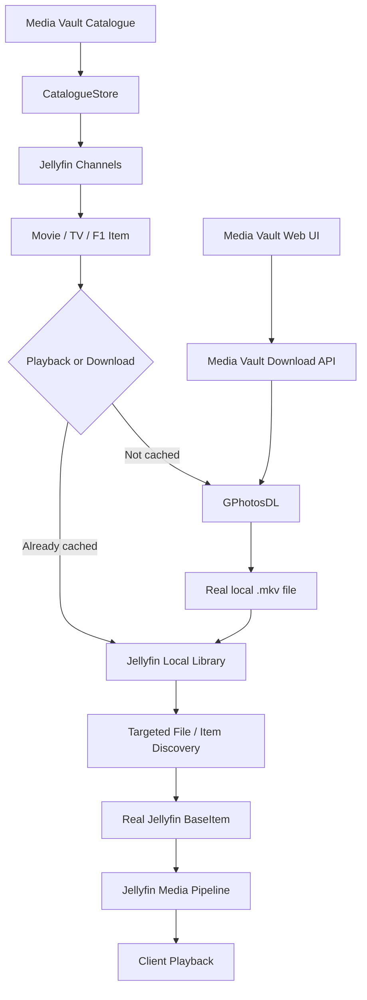

# 🎬 Media Vault for Jellyfin

A custom Jellyfin plugin that brings a **cloud-backed catalogue of Movies, TV Shows and Formula 1 content** into Jellyfin, with on-demand downloads through **GPhotosDL** and playback through Jellyfin's normal local media pipeline.

Media Vault does not pretend that cloud content is already a local media file. Instead, it exposes catalogue metadata through Jellyfin's supported **Channel** architecture and, when media is requested, coordinates with GPhotosDL to download the real `.mkv` file locally. Jellyfin can then discover and play that real file using its native media pipeline.

---

## ✨ What Media Vault Does

- 🎬 Provides **Movies**, **TV Shows** and **Formula 1** Channels.
- ☁️ Uses **GPhotosDL** to download media from Google Photos on demand.
- 📦 Stores downloaded media as real local `.mkv` files.
- ▶️ Uses Jellyfin's normal playback and media-source pipeline.
- ⚡ Uses targeted file/item discovery instead of unnecessary full-library scans.
- 💾 Recognises already-downloaded media and avoids downloading it again.
- 📊 Provides download progress through the Media Vault web interface.
- 🎨 Adds a Jellyfin-integrated download/cache panel to item detail pages.
- 🔤 Synchronises catalogue sort titles with Jellyfin Channel items.
- 🛡️ Keeps the last known-good catalogue when a catalogue refresh fails.
- 🆔 Uses deterministic Media Vault identities so catalogue items remain consistently identifiable.
- 📺 Works with Jellyfin clients that can use the normal local Jellyfin playback path.

---

## 🏗️ How It Works



The important distinction is that **Media Vault does not replace Jellyfin's playback system**. The plugin gets the media onto the local server and connects the catalogue item to the corresponding real Jellyfin library item. Jellyfin remains responsible for the actual media source and playback behaviour.

---

## 📸 See It In Action

**Home page showing Media Vault Channels: Cloud Movies, Cloud TV Shows and Cloud Formula 1 and Local Libraries: Local Movies, Local TV Shows and Local Formula 1**


**Download in progress:**


**Image: Media Vault download panel showing a completed cached item**


---

## 🧩 Core Architecture

Media Vault is split into a few clear responsibilities:

| Component | Responsibility |
|---|---|
| **CatalogueStore** | Loads, validates, maps and caches catalogue data |
| **Jellyfin Channels** | Exposes Movies, TV Shows and Formula 1 catalogue items |
| **Download API** | Starts, monitors and cancels Media Vault downloads |
| **GPhotosDlService** | Communicates with the GPhotosDL HTTP API |
| **Local Jellyfin Libraries** | Provide the real local media files Jellyfin plays |
| **Targeted Discovery** | Finds the expected downloaded file/item without unnecessary full-library scans |
| **Sort Title Service** | Keeps Channel-backed Movie sort titles aligned with the catalogue |
| **JavaScript UI** | Adds the Media Vault download/cache interface to Jellyfin |

---

## 🖥️ Compatibility

| Component | Supported / Target |
|---|---|
| **Jellyfin Server** | **10.11.11** |
| **.NET** | **9** |
| **Media Vault Plugin** | Built for Jellyfin 10.11.11 |
| **GPhotosDL** | Required for on-demand Google Photos downloads |
| **File Transformation** | Required for the Media Vault web interface |
| **JS Injector** | Required for the Media Vault web interface |
| **Local Jellyfin Libraries** | Required for downloaded media playback |
| **Movies** | ✅ Supported |
| **TV Shows** | ✅ Supported |
| **Formula 1** | ✅ Supported |
| **Growing-file playback** | ⚠️ Client-dependent |

### ⚠️ Client behaviour

The server-side plugin uses Jellyfin's normal media pipeline, but individual clients can differ in how they handle **growing media files** and dynamically injected web interfaces.

If a client cannot reliably play a file while it is still downloading, allow the download to complete and play the resulting media from the normal local Jellyfin library.

---

## 📦 Getting the Plugin

Everything required to install and use Media Vault is available from the repository's **[Releases](../../releases)** section.

The current release provides the individual components as well as a bundled installation package:

| Release asset | Purpose |
|---|---|
| `MediaVault.Jellyfin.dll` | Main Jellyfin plugin |
| `Media_Vault.js` | Media Vault JavaScript Injector script |
| `jellyfin-javascript-injector-scripts.json` | Importable JS Injector configuration |
| `Plugin.+.JS.Injection.zip` | Bundled plugin + JavaScript injection files |

The Releases section also contains the installation instructions needed to get the plugin running.

---

## 🚀 Installation Overview

For the complete step-by-step installation guide, see **[Installation](docs/INSTALLATION.md)**.

At a high level:

1. Install the Media Vault plugin DLL into Jellyfin's `Data/plugins/MediaVault.Jellyfin` directory.
2. Install the **File Transformation** and **JS Injector** Jellyfin plugins.
3. Configure the Media Vault JavaScript through JS Injector.
4. Configure the catalogue source, GPhotosDL connection and local download directories.
5. Ensure the corresponding local Jellyfin libraries include the Media Vault download directories.
6. Restart/refresh Jellyfin as required.

The detailed guide explains the repository manifests, plugin installation, JavaScript installation and initial configuration.

---

## 📚 Documentation

The project documentation is split into focused guides:

### 🛠️ [Installation](docs/INSTALLATION.md)

Complete beginner-friendly installation guide covering Jellyfin, the required supporting plugins, the Media Vault DLL, JavaScript injection and the initial setup required to get everything working.

### ⚙️ [Configuration](docs/CONFIGURATION.md)

Explains the Media Vault plugin settings, catalogue sources, GPhotosDL connection, download directories, refresh intervals, playback startup buffer, targeted discovery and sort-title synchronisation.

### 🏗️ [Architecture](docs/ARCHITECTURE.md)

Explains how the major Media Vault components fit together, including the catalogue, Channels, GPhotosDL, local media storage, targeted discovery and Jellyfin's native playback pipeline.

### 🧱 [Channel Architecture](docs/CHANNEL_ARCHITECTURE.md)

Detailed documentation of the Jellyfin Channel implementation and how Movies, TV Shows and Formula 1 catalogue items are represented and resolved.

### 🛠️ [Development](docs/DEVELOPMENT.md)

Developer guide covering the repository structure, restoring dependencies, building the plugin, running tests, publishing, packaging releases and working on the JavaScript component.

### 🩺 [Troubleshooting](docs/TROUBLESHOOTING.md)

Practical guide for diagnosing plugin visibility, catalogue, GPhotosDL, download, file discovery, playback, UI, focus and sort-order problems.

---

## 🎯 Design Principles

Media Vault is built around a few important principles:

- **Use Jellyfin's supported architecture** rather than directly manipulating the Jellyfin database.
- **Do not fake local media** — downloaded content exists as a real local file.
- **Keep catalogue failures non-destructive** by retaining the last known-good catalogue.
- **Keep Google Photos handling in GPhotosDL** and communicate with it through its HTTP API.
- **Use deterministic identities** for consistent catalogue item mapping.
- **Keep local discovery targeted** to reduce unnecessary filesystem work and improve playback startup on large libraries.
- **Let Jellyfin handle playback** once the real local media item has been discovered.

---

## 📁 Repository Documentation

```text
Media-Vault-Jellyfin-Plugin/
├── README.md
├── docs/
│   ├── ARCHITECTURE.md
│   ├── CHANNEL_ARCHITECTURE.md
│   ├── CONFIGURATION.md
│   ├── DEVELOPMENT.md
│   ├── INSTALLATION.md
│   ├── NATIVE_LIBRARY_SPIKE.md.md
│   └── TROUBLESHOOTING.md
├── src/
├── tests/
└── build.yaml
```

`build.yaml` contains Jellyfin plugin/build metadata; it is not a CI/CD workflow.

---

## 🤝 Contributing & Development

If you want to build or modify the plugin, start with **[Development](docs/DEVELOPMENT.md)**.

For a deeper understanding of the implementation, read **[Architecture](docs/ARCHITECTURE.md)** and **[Channel Architecture](docs/CHANNEL_ARCHITECTURE.md)**.

For problems during development or deployment, see **[Troubleshooting](docs/TROUBLESHOOTING.md)**.
